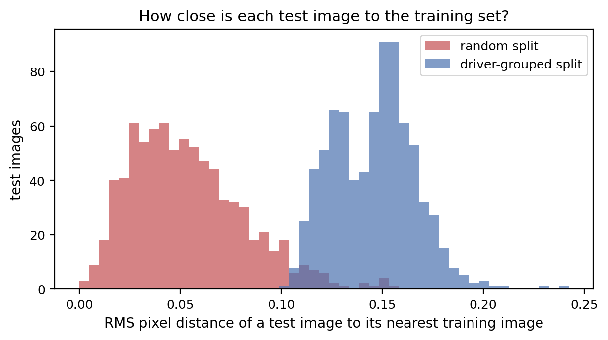
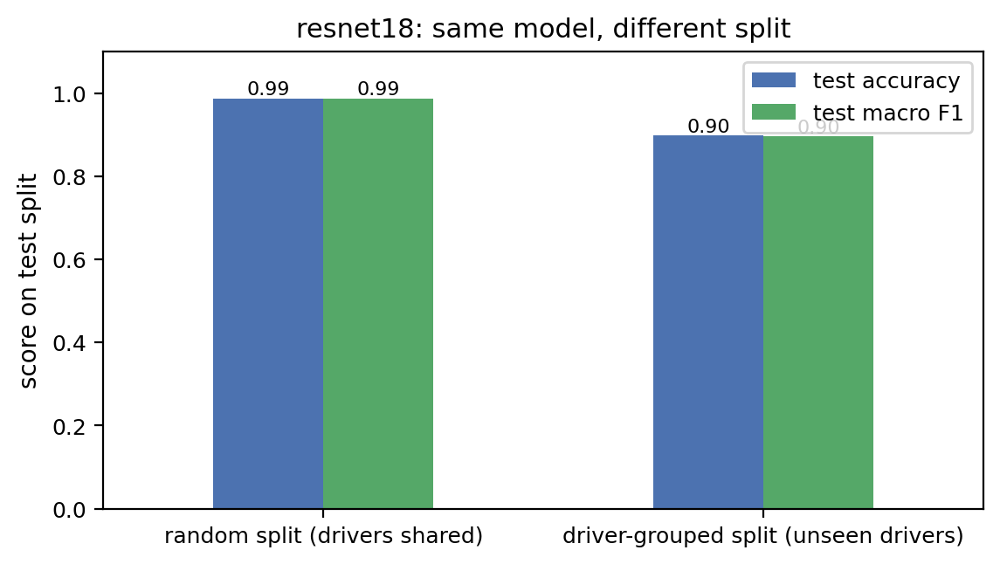
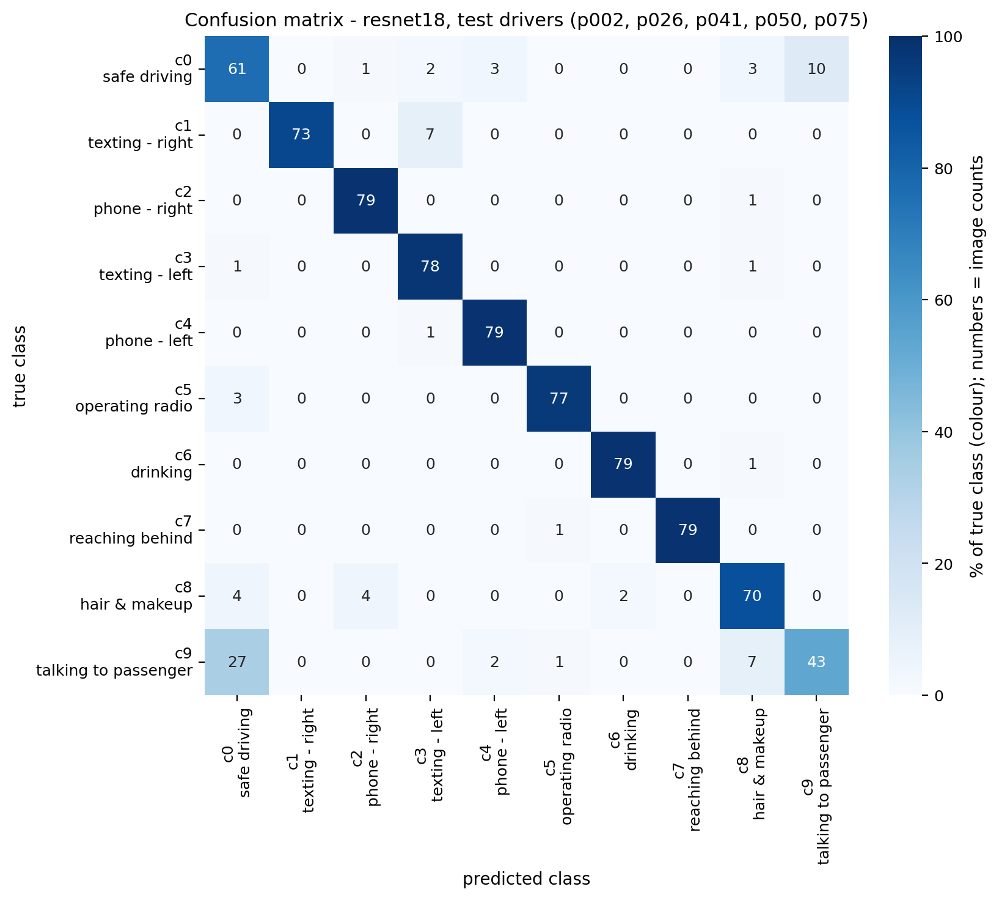
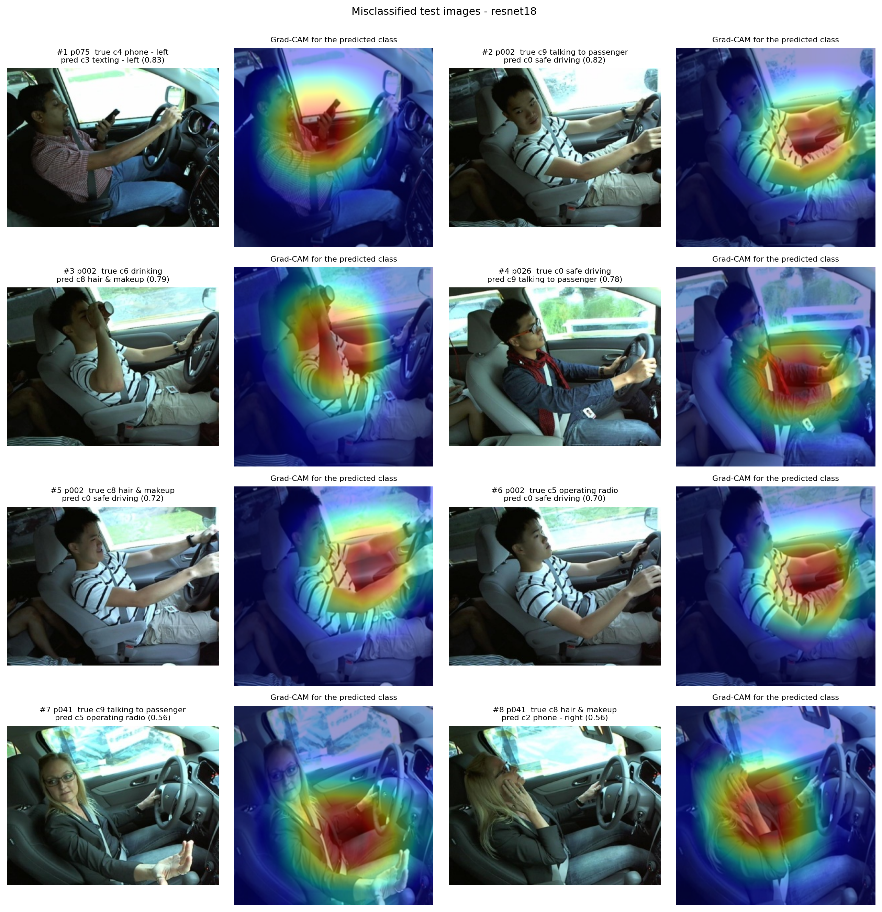

# PS-48 Distracted Driver Detection

**SRM Institute of Science and Technology, Tiruchirappalli** · B.Tech CSE (AI & ML) · Deep Learning, Challenge Based Learning (CBL)

| | |
|---|---|
| **Student** | Lokaraj R |
| **Register No.** | RA2311026050005 |
| **Section** | AIML B |
| **Problem statement** | PS-48 Distracted Driver Detection (Human-Centred Vision) |
| **Dataset** | [State Farm Distracted Driver Detection](https://www.kaggle.com/c/state-farm-distracted-driver-detection) (Kaggle), 22,424 labelled images, 26 drivers, 10 classes |
| **Notebook** | [`RA2311026050005_PS48.ipynb`](RA2311026050005_PS48.ipynb) |
| **Report** | [`RA2311026050005_PS48_Report.pdf`](RA2311026050005_PS48_Report.pdf) |

## The problem

Classify an in-car camera image of a driver into ten behaviours:

| c0 | c1 | c2 | c3 | c4 | c5 | c6 | c7 | c8 | c9 |
|---|---|---|---|---|---|---|---|---|---|
| safe driving | texting (right) | phone (right) | texting (left) | phone (left) | operating radio | drinking | reaching behind | hair & makeup | talking to passenger |

Every driver was filmed in one continuous session, so frames of the same driver are almost identical. If a driver appears in both the training and the test set, the model can recognise *the person* instead of the behaviour, and the score says nothing about a new driver. **The split is therefore made by driver**: each of the 26 drivers is in exactly one of train / validation / test.

## Results

All numbers are on the **5 test drivers (p002, p026, p041, p050, p075) that were never used for training or model selection**, 800 images (80 per class).

| Model | Params (M) | Val macro F1 | Test accuracy | Test macro F1 | Test log loss | Top-2 accuracy |
|---|---:|---:|---:|---:|---:|---:|
| CNN from scratch | 2.36 | 0.76 | 73.75 % | 0.72 | 0.82 | 86.88 % |
| MobileNetV3-Large | 4.21 | 0.70 | 78.00 % | 0.77 | 0.80 | 89.75 % |
| EfficientNet-B0 | 4.02 | 0.76 | 85.50 % | 0.85 | 0.54 | 94.38 % |
| **ResNet-18 (selected on validation)** | 11.18 | **0.85** | **89.75 %** | **0.90** | **0.48** | **96.00 %** |
| ResNet-18 on a *random* split (leaky) | 11.18 | 1.00 | 98.75 % | 0.99 | 0.14 | – |

### Why the driver split matters

The same ResNet-18 scores **98.75 %** when the split is random and **89.75 %** when the test drivers are new. Before training, 50.6 % of the random-split test images already have a near-identical frame (RMS pixel distance < 0.05) in the training set; with the driver split, none do.

| Nearest training image for each test image | Random split vs driver split |
|---|---|
|  |  |

### Where the model fails



* **talking to passenger → safe driving (27 of 80):** both poses have both hands on the wheel; only the head turn differs, and Grad-CAM shows the model looking at the arms rather than the face.
* **texting right → texting left (7):** horizontal flip was deliberately *not* used as augmentation, because it would swap these two classes.
* Per-driver accuracy ranges from 86.9 % (p002) to 93.1 % (p026).



### Robustness (no retraining)

| Condition | Test macro F1 | Drop |
|---|---:|---:|
| clean | 0.90 | – |
| low light (brightness × 0.5) | 0.88 | 0.01 |
| low resolution (80 × 60) | 0.82 | 0.07 |
| blur (Gaussian, σ = 2) | 0.80 | 0.10 |

## Method

* **Data:** balanced subset of up to 16 images per (driver, class) → 4,136 images. Driver split with seed 42: 17 train drivers (2,720 images), 4 validation (616), 5 test (800). Saved in [`outputs/splits/`](outputs/splits).
* **Pre-processing:** resize to 224 × 224, ImageNet normalisation. Training augmentation: random resized crop, ±10° rotation, colour jitter, random erasing. **No horizontal flip.**
* **Models:** a 5-block CNN from scratch, and ImageNet-pretrained MobileNetV3-Large, EfficientNet-B0 and ResNet-18 (2 epochs head only, then full fine-tuning).
* **Training:** cross-entropy with label smoothing 0.1, AdamW, one-cycle learning rate, early stopping on validation macro F1 (patience 4).
* **Selection:** on the validation drivers only; the test drivers were evaluated once.
* **Explainability:** Grad-CAM on the last convolutional block.

## Repository layout

```text
Distracted-Driver-Detection-PS48/
├── RA2311026050005_PS48.ipynb        notebook: EDA → split → training → evaluation → Grad-CAM → leakage test
├── RA2311026050005_PS48_Report.pdf   two-page report (SRM CBL format)
├── requirements.txt
└── outputs/
    ├── results.json                  every number used in the report
    ├── test_results_all_models.csv
    ├── leakage_experiment.csv
    ├── history_*.csv                 per-epoch training / validation metrics
    ├── splits/                       driver_split.csv, random_split.csv
    ├── figures/                      EDA, learning curves, confusion matrix, Grad-CAM, leakage plots
    └── versions.json                 library versions and hardware
```

## Reproducing the results

1. Accept the competition rules at https://www.kaggle.com/c/state-farm-distracted-driver-detection.
2. **Google Colab (recommended):** upload the notebook, choose *Runtime → Change runtime type → T4 GPU*, add your Kaggle API token as a Colab secret named `KAGGLE_API_TOKEN`, then *Run all*. The first code cell downloads the data.
3. **Locally:** unzip the data so that `data/driver_imgs_list.csv` and `data/imgs/train/c0 … c9/` exist, then

```bash
pip install -r requirements.txt
jupyter nbconvert --to notebook --execute --inplace RA2311026050005_PS48.ipynb
```

The seed (42), the saved splits and `outputs/versions.json` (PyTorch 2.11, Colab GPU) fix the run; training takes about 25 minutes on a T4.

## References

* State Farm Distracted Driver Detection, Kaggle, 2016.
* R. R. Selvaraju et al., "Grad-CAM: Visual Explanations from Deep Networks via Gradient-based Localization", ICCV 2017.
* K. He et al., "Deep Residual Learning for Image Recognition", CVPR 2016.
